# andagent

[English](README.md) · 简体中文

AndAgent 是运行在 Android 设备上的开源 AI 助手。对话可直接调用设备功能，包括文件、相册、日历、蓝牙、Wi-Fi、传感器、NFC、屏幕、Shell、数据库和脚本；结果在聊天流中以图表、图片、表格、音视频等卡片展示。

版本：**0.28.7**（versionCode 44），包名 `com.dc.andagent`。项目采用 [Apache-2.0](LICENSE) 协议，三方组件见 [开源组件声明](THIRD-PARTY-NOTICES.md)。

## 截图

| | | |
|---|---|---|
| 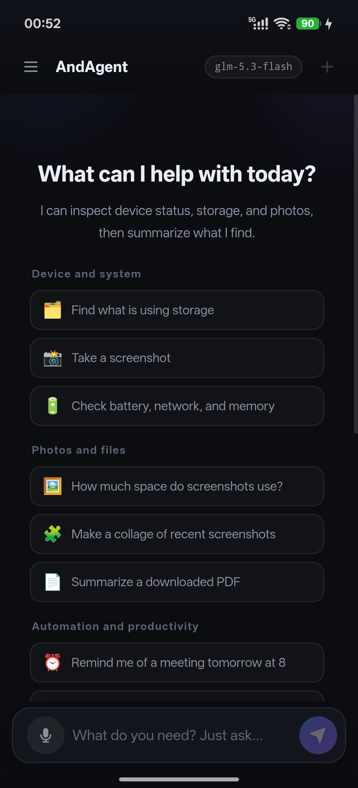 | 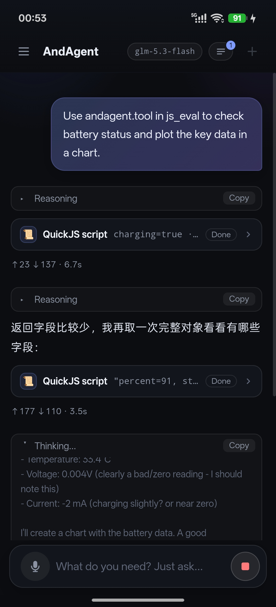 | 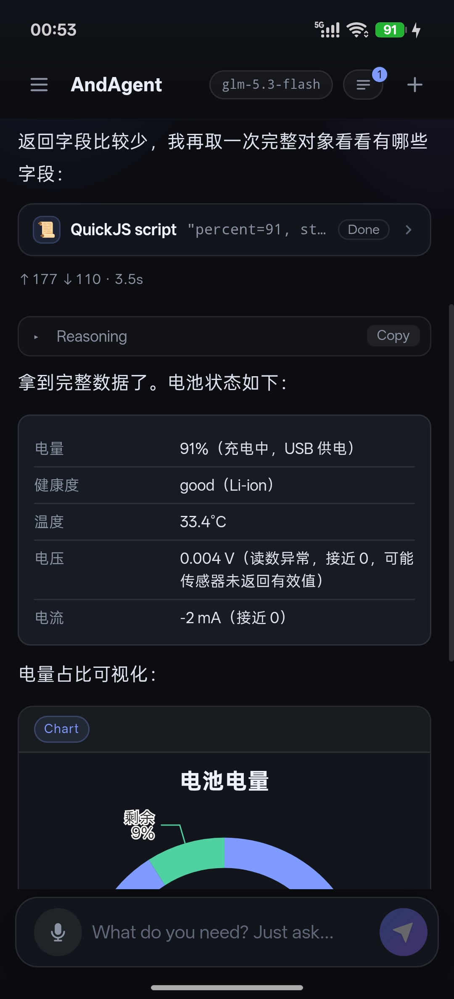 |
| *首页与建议提示* | *QuickJS 工具调用与推理过程* | *电池状态与 ECharts 图表卡片* |
| 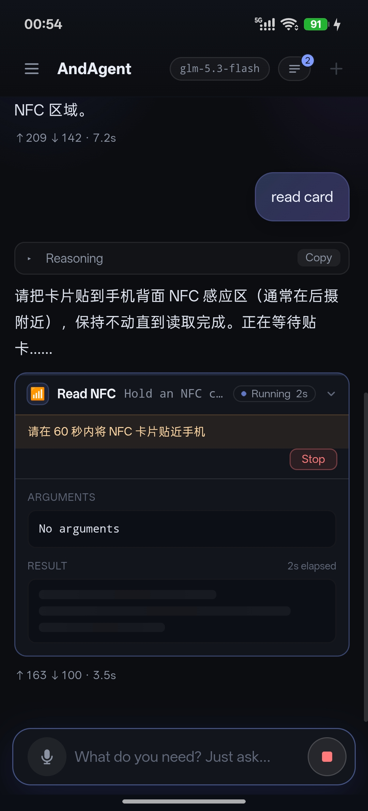 | 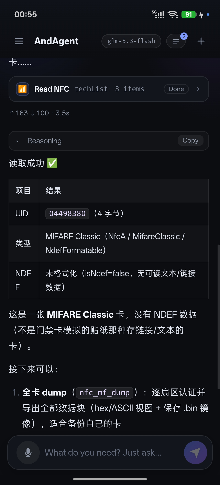 | 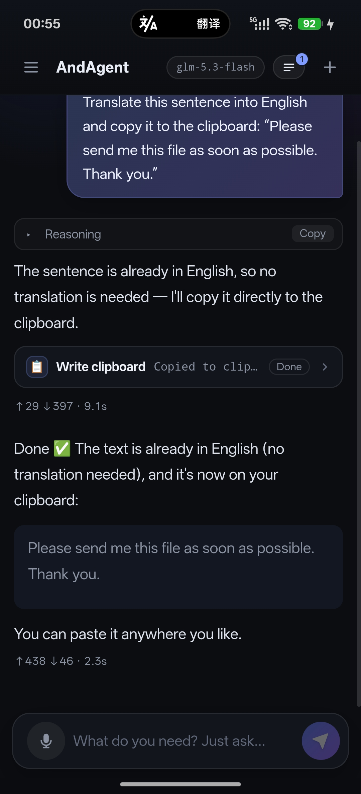 |
| *NFC 读卡进行中* | *NFC 读卡结果（MIFARE Classic）* | *剪贴板工具* |
| 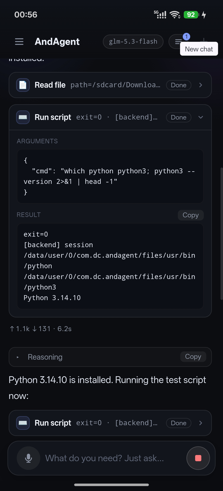 | 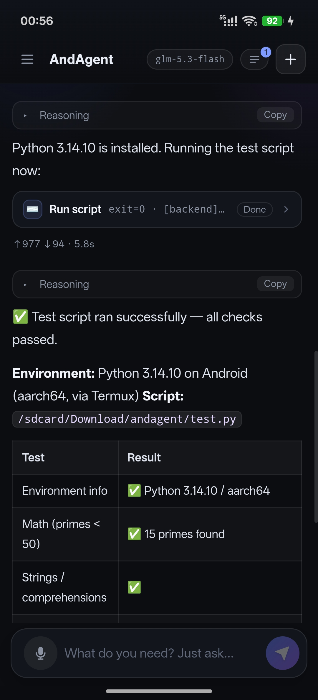 | 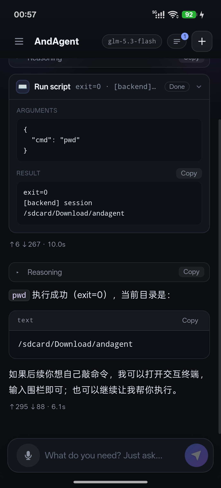 |
| *内嵌 Termux：Python 3.14* | *Python 脚本测试结果* | *shell_exec* |
| 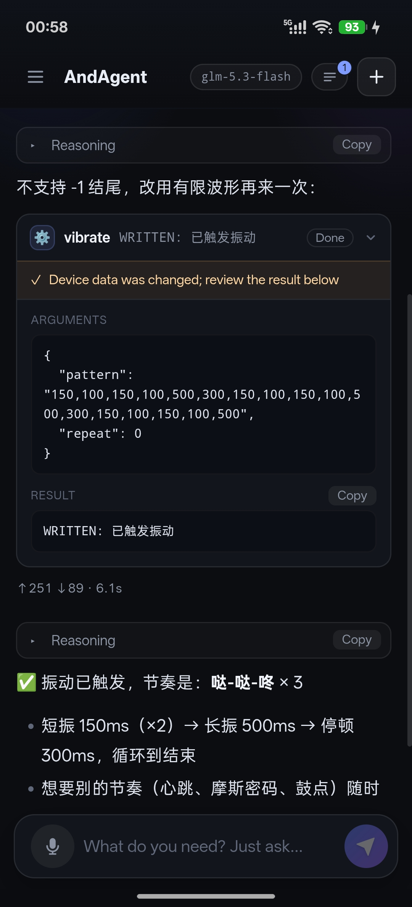 | 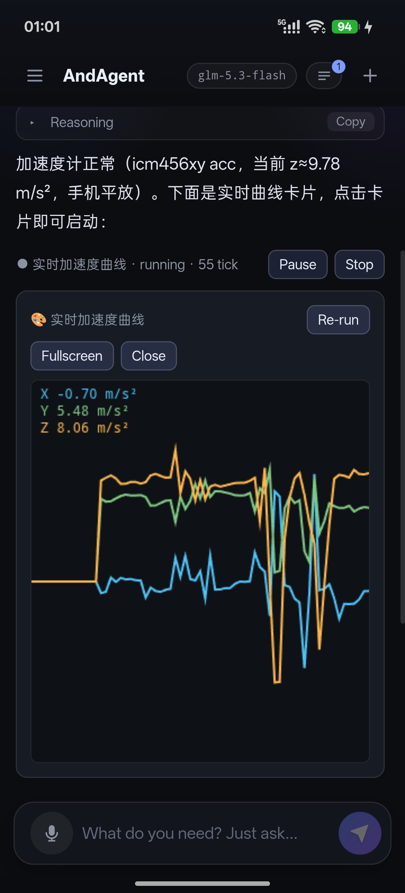 | 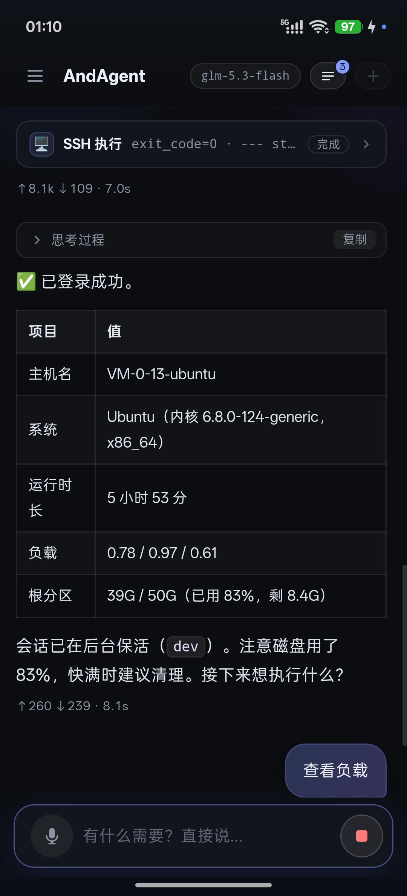 |
| *振动工具与写入标记* | *实时传感器曲线卡片* | *SSH 远程执行* |

## 主要能力

- React + assistant-ui + pi-ai 前端嵌入 APK；Kotlin 原生层执行工具、权限管理和 LLM 网络代理。
- 支持 OpenAI 兼容接口，自带 QuickJS 脚本、SQLite 浏览器、ADB 真机运维和内嵌 Termux 用户空间。
- LiveLoop 持续任务、分层记忆、定时任务、相机浮窗、MIFARE/NFC、OTG、语音录入与屏幕捕获。
- 本地 VPN（VpnService，纯应用权限、无需 root）：tun 只接管 DNS，因此不影响正常上网；提供 hosts 级广告拦截、按应用分流、全机分应用流量统计与 DNS 抓包（pcap 可拖进 Wireshark），工具族 `vpn_start/stop/status/traffic/split/hosts/diag`。
- 相机全能力：手动 ISO/快门/曝光补偿/对焦、超广角/长焦/微距物理镜头切换与光学变焦比、RAW(DNG)、DEPTH16 深度图与 PLY 点云、ImageAnalysis 连续帧分析（亮度/运动/条码/抽帧）、厂商相机扩展（夜景/HDR/人像虚化）。
- 设置里可切换跟随系统、中文、English；v1 覆盖框架主要文案，工具专属文案继续完善。

## 构建

需要 JDK 17、Android SDK 34、Node.js 20+，建议 NDK `26.1.10909125`。设备最低 Android 8.0。

```bash
cd web && npm ci && npm test && npm run build
cd .. && ./gradlew :app:assembleDebug :app:testDebugUnitTest
adb install -r app/build/outputs/apk/debug/app-debug.apk
```

只预览前端时执行 `cd web && npm run dev`：dev 模式会注入假 `AndroidBridge`（`web/src/devMockBridge.ts`，生产构建会整块移除），工具返回占位 JSON（可用 localStorage `andagent.dev.mock.tools` 覆盖），LLM 由浏览器直连模型端点（需允许 CORS）。设 `VITE_ANDAGENT_MOCK_BRIDGE=0` 可回到无桥预览。

首次启动、尚未配置模型时，会打开「连接大模型」引导：选择服务商，填写 API Key，获取模型列表或手动输入模型 ID，再点「测试并保存」验证工具调用。支持 DeepSeek、通义千问、Kimi、智谱、硅基流动、OpenRouter、OpenAI、Ollama、LM Studio 和自定义 OpenAI 兼容端点；本地服务可不填 Key，连接电脑时请将 localhost 改为电脑的局域网 IP。

可选择「稍后」跳过引导，或「不测试，直接保存」。之后随时点聊天页顶部的模型名称、未配置提示的「去配置」，或「设置 › 模型配置」重新连接。连接测试会发送一次简短请求，可能产生少量费用。密钥只保存在本机，不会编入 APK 源码。

仍支持把 `config.json` 放入设备 `Download/`（Android 11+ 建议同步到 `/sdcard/Android/data/com.dc.andagent/files/config.json`）。文件中的字段在读取配置时会覆盖本机保存值；使用界面配置后，如不希望被覆盖，请同步修改或移除该文件。

更多架构、权限、工具清单和配置细节见 [英文 README](README.md)。贡献前请读 [CONTRIBUTING.md](CONTRIBUTING.md)；安全问题通过 [GitHub Security Advisories](https://github.com/congduan/andagent/security/advisories/new) 私下报告。
